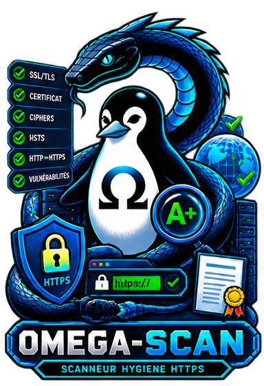

<!-- Copyright (c) 2026 kraynux - kraynux@proton.me - Лицензия MIT (см. файл LICENSE) -->
<div align="center">
  
</div>

# 🔍 OMEGA-SCAN

**Сканер веб-профиля безопасности**

> Разработано **kraynux** для **Omega-server**  
[https://kraynux.snake-mackarel.ts.net](https://kraynux.snake-mackarel.ts.net)

Официальная страница: [OMEGA-SCAN](https://kraynux.snake-mackarel.ts.net/omega-scan/) &nbsp; Обзор: [Screenshots](https://kraynux.snake-mackarel.ts.net/omega-scan/screenshots/)  

[](LICENCE)
[](https://www.python.org/)
[](https://www.linux.org/)
[](https://github.com/Textualize/rich)

**Языки:**  
[Français](README.md) · [English](README.en.md) · [Español](README.es.md) · [Русский](README.ru.md) · [中文](README.zh-CN.md)

---

**Omega-scan** — инструмент TUI + CLI, анализирующий видимую гигиену конфигурации HTTP/HTTPS-сервисов. Он наблюдает и собирает факты, применяет декларативные интерпретирующие правила и создаёт практичные отчёты, не выполняя активных атак. Это третий инструмент набора `omega-` (после `omega-fire` и `omega-stress`), организованный по принципам Clean Architecture; полное техническое описание см. в `ARCHITECTURE.md`.

## 1. Назначение и границы

Omega-scan — сканер веб-профиля безопасности для системного администрирования: он быстро проверяет видимую гигиену конфигурации HTTP/HTTPS-сервиса на localhost, в LAN или на внешней цели, включая цели за туннелем вроде Tailscale Funnel.

### Что делает Omega-scan

- Собирает наблюдаемые факты: заголовки, cookies, HTTP-методы, TLS, чувствительные пути и CORS-заголовки.
- Применяет к этим фактам декларативные интерпретирующие правила.
- Формирует однородные, обоснованные и практичные findings.
- Выводит результат в TUI на Textual или скриптуемом CLI, а также экспортирует его в JSON, текст и HTML.
- Обнаруживает ложные срабатывания, особенно поведение catch-all и пути, защищённые аутентификацией.
- Учитывает контекст: прокси, туннель, multi-vhost и SNI.
- Требует явного подтверждения разрешения перед сканированием цели, которая ещё не закреплена и не авторизована.
- Хранит постоянную историю сканирований по целям с возможностью повторного запуска и сравнения во времени.

### Чего Omega-scan не делает

- Не выполняет активное сканирование уязвимостей, SQLi, XSS или RCE.
- Не сканирует CVE.
- Не является инструментом bruteforce или массового fuzzing.
- Не выполняет глубокий crawling.
- Не выполняет агрессивное параллельное сканирование нескольких целей.
- Не предоставляет веб-панель.
- Не выполняет аутентификацию со стороны сканера.

## 2. Установка

### Требования

- Python 3.10+
- Подключение к Интернету для зависимостей и внешних сканирований

### Установка

Официальный архив предоставляется в формате `.tar.gz`. Перед установкой проверьте его целостность:

```bash
sha256sum omega-scan.tar.gz
```

### Способ 1 — скрипт установки

```bash
[ -d omega-scan ] && echo "ℹ️ Уже распаковано здесь, шаг пропущен." || tar -xzf omega-scan.tar.gz
[ -d ~/omega-scan ] && echo "ℹ️ ~/omega-scan уже существует, перемещение пропущено." || mv omega-scan ~/
cd ~/omega-scan/
chmod +x install.sh
./install.sh
```

### Способ 2 — надёжная полная установка

```bash
( [ -d omega-scan ] || tar -xzf omega-scan.tar.gz ) && \
( [ -d ~/omega-scan ] || mv omega-scan ~/ ) && \
cd ~/omega-scan && chmod +x install.sh && ./install.sh
```

`install.sh`:

1. Создаёт виртуальное окружение `.venv`, если оно ещё не существует.
2. Устанавливает зависимости (`pip install -e .`; `pyproject.toml` остаётся единственным источником истины).
3. Делает `omega-scan.sh` и `install.sh` исполняемыми.
4. Добавляет алиас `scan` в `~/.bashrc` и `~/.zshrc`, не создавая дубликат.

### Зависимости

Указаны в `pyproject.toml` (файл `requirements.txt` больше не используется):
- `textual`: TUI, темы и автоматическая адаптация к терминалу.
- `httpx`: современный HTTP/HTTPS-клиент.
- `jinja2`: шаблоны для HTML-экспорта.
- Зависимости разработки (`pip install -e ".[dev]"`): `pytest`, `pytest-asyncio`, `pytest-httpserver`, `trustme`, `ruff`, `mypy`, `import-linter`.

## 3. Использование

### Интерактивный режим (TUI)

Рекомендуется для ежедневной работы; запускается без аргументов:

```bash
./omega-scan.sh
```

Сценарий: стартовый экран (закрывается клавишей или щелчком) → главное меню → ввод цели и выбор профиля (с подтверждением разрешения, если цель ещё не закреплена) → сканирование (индикатор прогресса и сетевые операции отображаются в реальном времени) → результаты (общая оценка, findings с фильтрацией по категориям, подробности по щелчку строки) → экспорт, история и сравнение из главного меню. Адаптация к терминалу (цвета, размер и структурное упрощение) выполняется автоматически, ручные флаги отображения больше не нужны.

#### Горячие клавиши

| Клавиша | Действие |
|---|---|
| `↑` / `↓` | Перемещение между элементами экрана |
| `Tab` / `Shift+Tab` | Перемещение между полями формы |
| `Esc` | Возврат к предыдущему экрану (на стартовом экране подтверждается выход) |
| `t` | Следующая тема (применяется сразу, без подтверждения) |
| `r` | Обновить определение терминала |
| `a` | Показать справку |
| `q` | Выйти с подтверждением |

### Скриптуемый режим (CLI)

Любая подкоманда запускает CLI (обычный текст или JSON с `--json`):

```bash
# Сканирование цели (--authorize обязателен, если цель ещё не закреплена)
./omega-scan.sh scan example.org --profile standard --authorize
./omega-scan.sh scan 192.168.1.10 --profile local-lab --authorize --json

# История
./omega-scan.sh history list --host example.org
./omega-scan.sh history show scan-30577411758e
./omega-scan.sh history compare scan-aaa scan-bbb
./omega-scan.sh history replay scan-30577411758e

# Экспорт
./omega-scan.sh export scan-30577411758e --format html --output report.html

# Закреплённые и авторизованные цели (для следующих сканирований --authorize не нужен)
./omega-scan.sh targets pin example.org --note "согласие клиента 2026-08"
./omega-scan.sh targets unpin example.org
./omega-scan.sh targets list
```

### Защита авторизации цели

Сканирование не начинается без явного подтверждения разрешения (флажок в TUI, `--authorize` в CLI), за исключением уже закреплённой цели. Проверка выполняется на уровне приложения (`application/pipeline/guards/authorization_guard.py`), а не только интерфейсом.

### Допустимые форматы цели

```text
192.168.1.10                IPv4
192.168.1.10:8080           IPv4 с портом
::1                         IPv6
[2001:db8::10]:8443         IPv6 в скобках с портом
example.org                 Имя хоста
intranet.lan:8080/admin     Имя хоста с портом и путём
http://example.org          URL HTTP
https://example.org/admin   URL HTTPS
```

## 4. Профили сканирования

| Параметр | `quick` | `standard` | `extended` | `local-lab` |
|---|---|---|---|---|
| Назначение | Быстрая проверка | Полная (по умолчанию) | Углублённая | localhost / LAN |
| Тайм-аут подключения/чтения | 3 с / 6 с | 3 с / 6 с | 5 с / 10 с | 3 с / 6 с |
| HTTP-методы | OPTIONS | OPTIONS, TRACE | OPTIONS, TRACE, PUT, DELETE, PATCH | OPTIONS, TRACE |
| Проверка путей | Нет | Да (около 20) | Да (полная) | Да (около 20) |
| TLS | Нет | Да | Да (подробно) | Да (с допуском) |
| Проверка CORS | Нет | Да | Да | Да |
| Catch-all | — | Да | Да | Да |
| Политика HSTS | Не оценивается | Стандартная | Строгая | Допустимая |

### Какой профиль выбрать

- `quick`: быстрая проверка перед вводом в эксплуатацию.
- `standard`: полный аудит сервиса в production; рекомендуется.
- `extended`: углублённый аудит, включая рискованные HTTP-методы.
- `local-lab`: сканирование localhost или LAN без чрезмерного применения правил для публичных сервисов, особенно HSTS.

## 5. Архитектура

Omega-scan следует принципам **Clean Architecture** (domain / application / infrastructure / interfaces / ports / core / app / plugins / shared), согласованным с шаблоном набора `omega-` (см. `omega-stress`). Полное описание — дерево, правила зависимостей, функциональные цепочки, иерархия исключений и таксономия именования — находится в **`ARCHITECTURE.md`**, нормативном справочном документе.

```text
src/omega_scan/
├── domain/          Чистая бизнес-логика (цели, профили, сканирования, проверки, отчёты, темы...)
├── application/     Варианты использования (commands/queries), конвейер выполнения, guards
├── ports/           Контракты приложения (probers, repositories, exporters...)
├── infrastructure/  Конкретные реализации (httpx, SQLite; Textual находится НЕ здесь)
├── interfaces/      tui/ (Textual) и cli/ (скриптуемый), со строгим равенством функций
├── app/             Сборка (DependencyContainer, bootstrap, жизненный цикл)
├── core/, shared/   Общая терминология и утилиты, не относящиеся к бизнес-логике
└── plugins/         Подготовленная пустая структура (подтверждённых расширений нет)
```

Правила проектирования, неизменные с v1:
- `domain/checks/`: принимает решения по доказательствам и никогда не выполняет сетевые операции.
- `infrastructure/network/`: выполняет сетевые операции и никогда не принимает решения.
- `interfaces/`: отображает данные и не содержит бизнес-логики.
- `infrastructure/exporters/`: читает результаты сканирования и ничего не пересчитывает.

## 6. Таксономия правил

### Транспорт, `TRN-*`

- `TRN-HTTP-001`: HTTP доступен без перенаправления на HTTPS, `WARN`.
- `TRN-HTTPS-001`: HTTPS недоступен, `FAIL`.
- `TRN-HSTS-001`: заголовок HSTS отсутствует, `FAIL`.
- `TRN-HSTS-002`: низкий `max-age` HSTS, менее одного года, `WARN`.

### Глубина TLS, `TLS-*`

- `TLS-VERSION-001`: устаревший протокол TLS (< TLSv1.2), `FAIL`.
- `TLS-CIPHER-001`: явно слабый шифр (RC4, DES, NULL, EXPORT, MD5), `WARN`.

### Заголовки, `HDR-*`

- `HDR-CSP-001`: CSP отсутствует на HTML-странице, `FAIL`.
- `HDR-CSP-002`: слишком разрешающая CSP, `WARN`.
- `HDR-NOSNIFF-001`: `X-Content-Type-Options` отсутствует, `WARN`.
- `HDR-SERVER-001`: баннер `Server` раскрыт, `WARN`.
- `HDR-CACHE-001`: `Cache-Control` отсутствует или слишком разрешающий на HTML-странице, `WARN`.

### Cookies, `COO-*`

- `COO-SECURE-001`: cookie в HTTPS-ответе без атрибута `Secure`, `WARN`.
- `COO-HTTPONLY-001`: cookie без атрибута `HttpOnly`, `WARN`.
- `COO-SAMESITE-001`: `SameSite` отсутствует или имеет значение `None` без `Secure`, `WARN`.

### CORS, `COR-*`

- `COR-WILDCARD-CREDENTIALS-001`: `Access-Control-Allow-Origin: *` вместе с `Access-Control-Allow-Credentials: true`, `FAIL`.
- `COR-REFLECTED-ORIGIN-001`: произвольный origin отражается как есть в `Access-Control-Allow-Origin`, `WARN`.

### HTTP-методы, `MTH-*`

- `MTH-OPTIONS-001`: метод OPTIONS включён, `INFO`.
- `MTH-TRACE-001`: метод TRACE включён, `WARN`.
- `MTH-PUT-001`: метод PUT включён, `WARN`.
- `MTH-DELETE-001`: метод DELETE включён, `WARN`.
- `MTH-PATCH-001`: метод PATCH включён, `WARN`.
- `MTH-CONNECT-001`: метод CONNECT включён, `WARN`.

### Экспозиция, `EXR-*`

- `EXR-ADMIN-001`: административный путь доступен без аутентификации, `WARN`.
- `EXR-SENSITIVE-001`: чувствительный файл доступен (`.env`, `.git`), `FAIL`.

### Утечки информации, `INF-*`

- `INF-BANNER-001`: серверные баннеры раскрыты, `WARN`.
- `INF-ERROR-001`: подробные сообщения об ошибках, `WARN`.
- `INF-STACK-001`: stack trace раскрыт, `FAIL`.
- `INF-ROBOTS-001`: `robots.txt` присутствует, информационный `OK`.
- `INF-HEADER-001`: слишком подробные технические заголовки, `WARN`.
- `INF-SECURITYTXT-001`: `/.well-known/security.txt` присутствует, информационный `OK`.

## 7. Политика доверия

| Уровень | Определение |
|---|---|
| `certain` | Прямое, однозначное доказательство, прочитанное из ответа: заголовок присутствует или отсутствует, исходный HTTP-код. |
| `high` | Ясное доказательство с косвенным контекстом: методы через OPTIONS, обнаруженный cookie. |
| `medium` | На результат могли повлиять посредник, прокси, WAF или туннель. |
| `low` | Косвенное обнаружение, неоднозначное содержимое или состояние `catch_all_suspected`. |

### Автоматическое понижение

- `catch_all_suspected = true`: доверие ограничивается уровнем `low`.
- `proxy_suspected = true`: доверие ограничивается уровнем `medium`.
- `observed_access_state = ambiguous`: доверие ограничивается уровнем `low`.

## 8. Обнаружение ложных срабатываний

### Поведение catch-all

Перед проверкой чувствительных путей Omega-scan генерирует случайный маловероятный путь. Если сервер отвечает `200 OK`, цель помечается как `catch_all_suspected = true`, а все findings об экспозиции понижаются до `confidence = low`.

### Аутентификация и отсутствие

Защищённый путь, ответы `401`, `403` или перенаправление на страницу входа не помечаются ни как отсутствующие, ни как открытые. Они получают статус `N/A` с примечанием: «защищённый путь; наличие невозможно подтвердить без аутентификации».

### Прокси / туннель

При обнаружении заголовков `X-Forwarded-*`, `Via` или `Forwarded` поле `proxy_suspected` становится `true`, а доверие к связанным findings (баннеры, TLS) ограничивается уровнем `medium`.

## 9. Совместимость с терминалами

TUI на Textual автоматически определяет возможности терминала (цвет и размер) и адаптирует структурную таблицу стилей (`complete`/`standard`/`reduced`/`mono`); ручные флаги (`--no-emoji`, `--no-color`, `--plain`), как в v1, больше не нужны. CLI всегда остаётся обычным текстом (или `--json`) и не зависит от терминала.

## 10. Экспорт

По умолчанию отчёты создаются в `var/exports/` (runtime-путь, см. `ARCHITECTURE.md`) или по указанному пути (`--output` в CLI, диалог в TUI).

### JSON — источник истины

Полная структура сканирования (`ScanRun`), строго сериализуемая в JSON.

### Текст — компактный отчёт

Читается вне терминала, без ANSI-кодов, с иерархической структурой.

### HTML — читаемый веб-отчёт

Автономный отчёт со встроенным CSS, доступный в любом браузере, пригодный для совместного использования и архивирования.

## 11. История и сравнение

Каждое сканирование сохраняется в SQLite (`var/db/app.db`): историю можно искать по цели, просматривать детали прошлого запуска, сравнивать два сканирования (появившиеся, устранённые, неизменившиеся и изменившиеся findings) и повторять сканирование той же цели без повторного ввода. Эти функции отсутствовали в v1 и появились при миграции на Clean Architecture.

## 12. Тесты

```bash
source .venv/bin/activate
pytest tests/ -v
```

Структура: `tests/unit/` (domain и application, без реального I/O), `tests/integration/` (SQLite/реальные файлы, фиктивный HTTP-сервер `pytest-httpserver`), `tests/e2e/` (сквозные CLI и TUI, `Textual.testing`).

## 13. Вне области проекта

- Сканирование CVE.
- Активное обнаружение SQLi, XSS и RCE.
- Сложная аутентификация со стороны сканера.
- Глубокий crawling.
- Fuzzing.
- Массовый bruteforce путей.
- Одновременное сканирование нескольких целей.
- Агрессивный параллелизм.
- Веб-панель.

---

> Omega-scan — наблюдать, собирать, интерпретировать, формировать отчёты.  
> Сканер профиля безопасности, а не инструмент атаки.
